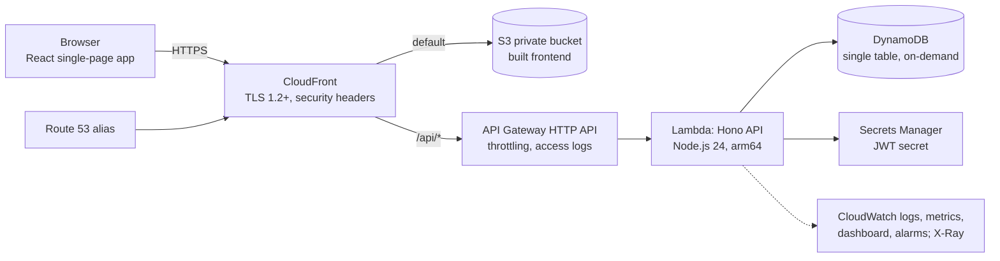
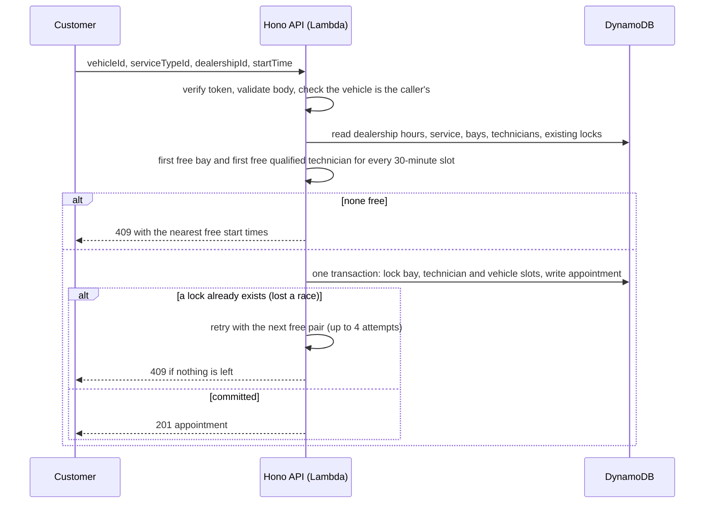

# System Design: Unified Service Scheduler

Proof of concept for Scenario A (Ownership). A customer books a service for a vehicle at a dealership; the system confirms only when a **service bay** and a **qualified technician** are both free for the whole duration, and stores an **appointment** linking customer, vehicle, technician and bay. It is live at https://asa-challenge.fibosolutions.com.

In scope: sign-in with customer and staff roles, a customer dashboard, booking, cancelling (which frees the resources), a staff overview, seeded demo data, deployment to AWS, and observability. Out of scope: see section 11 and [OUT_OF_SCOPE.md](OUT_OF_SCOPE.md).

## 1. Architecture

Production (AWS, ap-southeast-1):

Local development: Vite dev server (proxies `/api`) and the same Hono app on Node, against DynamoDB Local in Docker. The Hono app is one `fetch` function; a small adapter exposes it to Lambda and another to Node, so local and cloud run the same code.

| Component | Role |
|---|---|
| Frontend (`frontend/`) | React app: sign-in, dashboard, booking wizard, staff overview. No business rules; it asks the API what is free. |
| CloudFront + S3 | One public entry point: serves the app from a private bucket and forwards `/api/*` to the API. Same origin, so no CORS. |
| API Gateway + Lambda (`backend/`) | Hono API: auth, catalog, availability, booking, cancel, listing. Stateless. |
| DynamoDB | Catalog, users, vehicles, appointments and the slot locks that prevent double booking. |
| Secrets Manager | JWT signing secret, generated at deploy time. |
| CDK (`infra/`) | Creates everything above from code. |
| Shared contracts (`shared/`) | Zod schemas and types used by both the API and the frontend. |

## 2. Data flow

Booking (`POST /api/appointments`):

Cancel (`POST /api/appointments/{id}/cancel`): checks the caller owns the booking (or is staff), then in one transaction marks it `CANCELLED` and deletes its lock items. The bay, technician and vehicle are free again immediately. Appointments that have already started cannot be cancelled.

Reads: the customer dashboard queries one index by customer; the staff overview queries one index per dealership and merges; availability returns, for a dealership, service and date, the start times where a bay and a qualified technician are free for the full duration.

## 3. Data model and the double-booking guarantee

Entities: Dealership (timezone, opening hours Mon to Sat), ServiceBay, Technician (skills), ServiceType (one skill, duration 30, 60, 120 or 240 minutes), User (customer or staff), Vehicle (owned by a customer) and Appointment (customer, vehicle, technician, bay, service, dealership, start and end in UTC, status `BOOKED` or `CANCELLED`). "Completed" is derived from `endTime < now`, so no job updates statuses.

**The rule.** Time is divided into 30-minute slots; every duration is a whole number of slots. An appointment occupies the half-open interval `[start, start + duration)`, so a job ending at 10:00 and one starting at 10:00 do not conflict.

**Slot locks.** For each slot an appointment covers, the booking writes three small lock items: one per bay, one per technician and one per vehicle. The lock puts and the appointment go into **one `TransactWriteItems` call**, each lock with the condition `attribute_not_exists(PK)`. If any slot is taken, nothing is written. DynamoDB serializes concurrent transactions on the same item, so two simultaneous requests for one slot cannot both commit, however many Lambda instances run. The vehicle lock also absorbs double clicks and stops one vehicle being booked twice. The largest booking (240 minutes) writes 8 slots x 3 locks + 1 appointment = 25 items, under the 100-item limit.

**Table layout** (single table, no scans):

| Item | PK | SK | GSI1 | GSI2 |
|---|---|---|---|---|
| Dealership, bay, technician | `DLR#<id>` | `META`, `BAY#<id>`, `TECH#<id>` | | |
| Service type | `SVC#<id>` | `META` | | |
| User, vehicle | `USER#<username>` | `META`, `VEH#<id>` | | |
| Appointment | `APPT#<id>` | `META` | `CUST#<username>` / `<start>#<id>` | `DLR#<id>` / `<start>#<id>` |
| Lock | `LOCK#<BAY\|TECH\|VEH>#<id>` | `<slotStartISO>` | | |

## 4. API

All routes are under `/api`; bodies are JSON validated by Zod; errors use `{ "error": { "code", "message", "requestId" } }`.

| Method and path | Role | Purpose |
|---|---|---|
| `POST /auth/login` | public | Username and password for a signed token (8 hours) |
| `GET /health` | public | Liveness |
| `GET /me` | any | Current user and role |
| `GET /catalog` | any | Dealerships, service types, categories |
| `GET /vehicles` | customer | The caller's vehicles |
| `GET /availability?dealershipId&serviceTypeId&date` (optional `vehicleId`) | Bookable start times for that day |
| `POST /appointments` | customer | Book |
| `GET /appointments` | customer, staff | Customer: own. Staff: all, filter by `dealershipId`, `from`, `to`, `status` |
| `GET /appointments/{id}` | owner, staff | One appointment |
| `POST /appointments/{id}/cancel` | owner, staff | Cancel and free resources |

Status codes: `400` invalid input, `401` no or bad token, `403` wrong role or someone else's booking, `404` not found, `409` (`SLOT_UNAVAILABLE` with alternative times, `VEHICLE_BUSY`, `ALREADY_CANCELLED`, `CANNOT_CANCEL_PAST`), `422` `INVALID_START_TIME` (off the 30-minute grid, outside opening hours, under 1 hour ahead or over 60 days ahead), `429` from API Gateway throttling (its own body; the web app shows a readable message).

Access control is enforced on the server: every route except login and health needs a token; a customer reads and cancels only their own appointments and books only their own vehicles; staff read and cancel everything but cannot create bookings.

## 5. Observability

| Area | What is implemented |
|---|---|
| Logs | Structured JSON (Powertools Logger), one line per request with request id, username, role, route, status and latency; booking lines add appointment, dealership, bay and technician. Passwords and tokens are never logged. The client gets an `X-Request-Id` header, so a user report maps to one log query. 30-day retention. API Gateway access logs go to their own group. |
| Metrics | Business metrics through CloudWatch Embedded Metric Format: `BookingCreated`, `BookingConflict`, `BookingCancelled`, `AvailabilityQueried`, `LoginSucceeded`, `LoginFailed`, `BookingLatency`. Plus API Gateway, Lambda and DynamoDB metrics. |
| Tracing | X-Ray on the Lambda function (HTTP APIs cannot trace, so a trace starts at the function), with subsegments `findCandidates` and `commitBooking`. |
| Dashboard | One CloudWatch dashboard `asa-challenge`: requests and errors, p50/p95/p99 latency, bookings vs conflicts vs cancellations, sign-ins, Lambda and DynamoDB throttling, booking latency, alarm status. |
| Alarms | API 5xx, Lambda errors, p95 latency above 3 s, DynamoDB throttling, 20 or more failed sign-ins in 5 minutes. They notify an SNS topic that emails an address if `ALARM_EMAIL` is set at deploy time. |

The conflict rate is the business signal that a dealership needs another bay or technician.

## 6. Security

| Concern | Control |
|---|---|
| Access | The API refuses every data request without a token. Fixed demo users; passwords stored as salted scrypt hashes, compared in constant time, case sensitive. |
| Token | HS256 JWT, secret from Secrets Manager, 8-hour expiry, role in the claims. |
| Transport | HTTPS only (HTTP redirects), TLS 1.2+, HSTS, CSP and other security headers set by CloudFront. |
| Storage | S3 private behind CloudFront origin access control; DynamoDB encrypted at rest with point-in-time recovery. |
| Abuse | API Gateway throttling (50 requests/second, burst 100); failed sign-ins are a metric and an alarm. |
| IAM | The Lambda role can reach only its own table and secret. |
| Input | Zod validation on every request. Username and password 1 to 32 characters, no white space in a password, record ids up to 64, search up to 100; every text box has the same `maxlength`. The API stores no free text from users. |

This gate suits a demo; a product would use a managed identity provider (for example Cognito), and only the token middleware would change.

## 7. Technology choices

| Area | Choice | Why |
|---|---|---|
| Language | TypeScript everywhere | One language for UI, API and infrastructure; shared types between frontend and backend |
| API | Hono on Lambda (Node.js 24, arm64) | Small, built on web-standard Request/Response, so the same app runs on Lambda and locally; cheap and fast on Graviton |
| Validation | Zod | The schema is the documentation and the TypeScript type; the frontend reuses it |
| Database | DynamoDB, single table, on-demand | Transactions give atomic multi-resource booking; no server to run; pay per request. PostgreSQL with a time-range exclusion constraint would also work but needs a server, networking and patching, which lengthens the reviewer's deploy |
| Frontend | React, Vite, Tailwind, TanStack Query, React Router | Mainstream and easy to review; static build suits S3 and a CDN |
| Hosting | S3 + CloudFront | Nothing to run; CDN, TLS and security headers in one place |
| Infrastructure | AWS CDK (TypeScript) | One command deploys and the stack is readable as code |
| Observability | Powertools for AWS Lambda, CloudWatch, X-Ray | Consistent log, metric and trace fields with little code |
| Tests | Vitest (with DynamoDB Local), Python scripts, Claude in Chrome | See section 10 |
| Images | Generated with Gemini through Alice's image skill (38 WebP files, about 1.1 MB) | Faces, places and cars instead of text blocks; one shared style prompt keeps them consistent; each record stores an image key, so art can be replaced without code changes |

## 8. Frontend behaviour

- Light interface; the sign-in page shows the username and password rules, with a wide photo on large screens and a banner on phones.
- On phones the booking summary and the Confirm button are a bar pinned to the bottom of the screen (below 1024 px); from 1024 px up it is a sticky card on the right.
- The client waits at most 20 seconds, says at once when the browser is offline, sends no second request on a double click, and returns the person to the page they asked for after signing in.
- After a booking, "Book another" keeps the vehicle and clears the other choices.

## 9. Seed data

`npm run seed:local` and `npm run seed:aws` load the same data; appointment dates are relative to the seed day.

- 3 dealerships in England (Kensington Motor Works, London; Brum Auto Centre, Birmingham; Northern Quarter Garage, Manchester), timezone `Europe/London`, open Monday to Saturday.
- 5 bays (2, 2 and 1) and 13 technicians (5, 4 and 4) with 2 to 3 skills each; every dealership covers all 7 skills, and some skills have a single qualified technician.
- 24 service types in 7 skill categories (Oil & Fluids, Brakes, Tyres & Wheels, Engine & Transmission, Electrical & Battery, Climate Control, Servicing MOT & Inspection): 6 of 30 minutes, 8 of 60, 6 of 120, 4 of 240.
- 3 users, password equal to username, case sensitive: `JoinWick` and `JamesBond` (customers), `Winston` (staff). John Wick has three vehicles and James Bond four.
- 10 appointments, some upcoming, some past and some cancelled, so no dashboard starts empty.

## 10. Testing

Commands and latest results: [TESTING.md](TESTING.md).

| Level | Tool | Covers |
|---|---|---|
| Unit | Vitest | Slot maths, overlap, opening hours, password hashing, clock-change days, pairwise generator |
| Integration | Vitest + DynamoDB Local | Booking and cancel on a real transaction engine, including parallel bookings of one slot (exactly one succeeds); boundary values and pairwise combinations |
| API black-box | Python scripts (standard library) | Roles, validation, boundaries, pairwise, concurrency, every text input, post-deploy smoke test; run against local or the live URL |
| UI | Claude in Chrome and the manual sheet [MANUAL_TEST_CASES.md](MANUAL_TEST_CASES.md) | Sign-in, booking, conflict with nearest times, cancel, staff view, phone width; screenshots in `docs/test-evidence/` |

## 11. Deployment, assumptions and limits

- `npm run deploy` builds the frontend and deploys one CDK stack to ap-southeast-1. With `DOMAIN_NAME`, `HOSTED_ZONE_ID` and `HOSTED_ZONE_NAME` it adds the Route 53 alias and, unless `CERTIFICATE_ARN` is given, a certificate in us-east-1. Without a domain the app is served from the CloudFront URL. `npm run seed:aws` loads the demo data; `npm run destroy` removes the stack.
- One environment (production) plus local development.
- Duration is fixed per service type; a service needs one skill; any bay can host any service; the system assigns the first free bay and technician.
- Bookings start on 30-minute boundaries within one day's opening hours, at least 1 hour ahead and at most 60 days ahead. Times are stored in UTC and shown in the dealership timezone.
- No buffer between jobs, holidays or multi-day jobs. Customers and vehicles are seeded; there is no registration.
- Not built: payments, notifications, rescheduling (cancel and rebook), waitlists, a real identity provider, staff pagination. Weak points found in review are listed with reasons in [OUT_OF_SCOPE.md](OUT_OF_SCOPE.md).
- Under heavy load on one technician or bay, transaction conflicts are retried (up to 4 attempts with a short random delay) and then returned as a clear 409.
