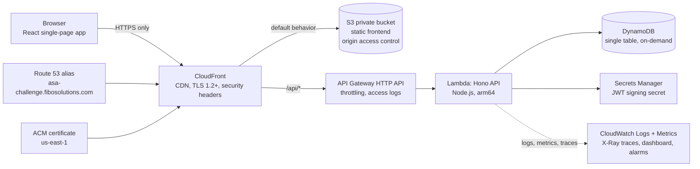
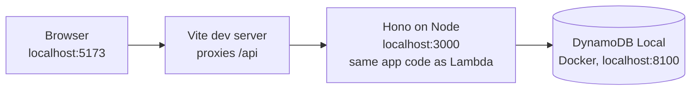
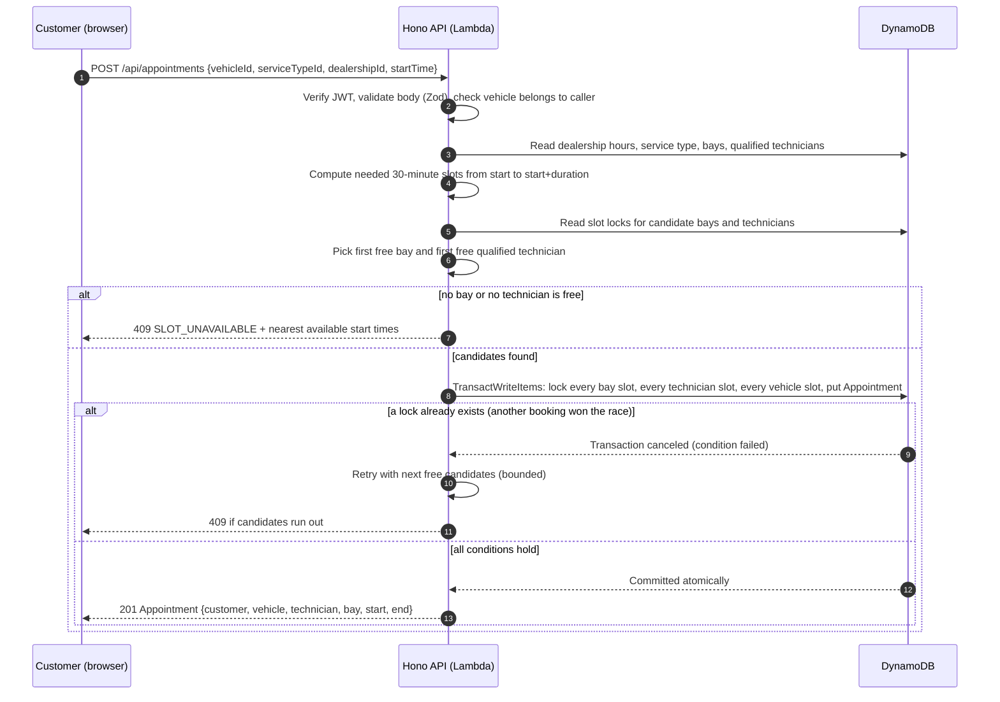

# System Design Document: Unified Service Scheduler

> Status: implemented. This document states the design intent; where the build differs, section 4 of [IMPLEMENTATION_RESULTS.md](IMPLEMENTATION_RESULTS.md) lists each difference and the reason.
> Scenario A (Ownership): replace manual dealership booking with a system that books only what the dealership can actually serve.

## 1. Problem and goals

A service department promises appointments by phone or paper. Two customers get the same bay, or a job is promised to a technician who lacks the skill. The system must:

1. Accept a request for **vehicle + service type + dealership + desired time**.
2. Confirm only when a **ServiceBay** and a **qualified Technician** are both free for the **entire service duration**.
3. Persist an **Appointment** that links customer, vehicle, technician and bay.

Additional scope agreed for the full project: login gate, customer and staff roles, a customer dashboard, cancellation that frees resources, seeded demo data, an AWS deployment at `https://asa-challenge.fibosolutions.com`, and observability.

### Principles behind every decision

| Principle | Meaning here |
|---|---|
| **Clarity** | One way to do each thing. Few moving parts. A reviewer can read the code path of a booking in one sitting. |
| **Logic** | The booking rule lives in one place (the booking service) and is enforced by the database, not by hope. |
| **Foresight** | Choices keep the next step cheap: more dealerships, more roles, a real identity provider, a different UI. Nothing is built for features nobody asked for. |

## 2. Architecture

### 2.1 Production (AWS, region ap-southeast-1)



### 2.2 Local development



The Hono application is a plain function `app.fetch`. A 5-line adapter exposes it to Lambda, another to Node. Local and cloud run the same business code.

## 3. Components and roles

| Component | Role | Why this shape |
|---|---|---|
| **Frontend SPA** (`frontend/`) | Login, customer dashboard, booking wizard, cancel, staff overview. Holds no business rules; it asks the API what is available and shows the answer. | The UI stays replaceable. All rules are testable without a browser. |
| **CloudFront** | Single public entry point. Serves the SPA from S3 and forwards `/api/*` to API Gateway. Terminates TLS, adds security headers (HSTS, CSP, no-sniff). | One origin for page and API means no CORS configuration and no mixed-content risk. Chrome accepts the site because every request is HTTPS. |
| **S3 (private)** | Stores the built frontend. Reachable only through CloudFront (origin access control). | No public bucket to misconfigure. |
| **API Gateway (HTTP API)** | Routes and throttles requests, writes access logs. | Cheapest managed front door for Lambda; throttling is the first defense against abuse of the public URL. |
| **Lambda: Hono API** (`backend/`) | Auth, catalog, availability, booking, cancel, listing. Stateless. | Scales to zero and to bursts; the demo costs cents. |
| **Booking service** (module in backend) | The only code that decides availability and writes appointments. | One place for the core rule. Routes stay thin. |
| **DynamoDB** | Holds catalog, users, vehicles, appointments and the **slot locks** that make double booking impossible. | See section 6. |
| **Secrets Manager** | Holds the JWT signing secret generated at deploy time. | No secret in the repository or in an environment variable. |
| **CloudWatch + X-Ray** | Structured logs, business metrics, traces, dashboard and alarms. | See section 8. |
| **Infrastructure (CDK)** (`infra/`) | Creates all of the above from code. | A reviewer deploys with one command and can read exactly what exists. |
| **Shared contracts** (`shared/`) | Zod schemas and TypeScript types for API requests and responses, used by backend and frontend. | The two halves cannot drift apart. They remain separate deployables. |

## 4. Data flow

### 4.1 Booking (the core flow)



### 4.2 Cancel

`POST /api/appointments/{id}/cancel` verifies the caller owns the appointment (or is staff), then in one transaction sets the status to `CANCELLED` and deletes every lock item that points at it. The bay, technician and vehicle are bookable again immediately.

### 4.3 Read paths

- Customer dashboard: query by customer on a secondary index, newest first.
- Staff overview: query each dealership on a second index, filtered by date range, merged in the API.
- Availability: for a chosen dealership, service and date, return the start times at which a bay and a qualified technician are free for the full duration.

## 5. Domain model

```
Dealership 1---* ServiceBay
Dealership 1---* Technician *---* Skill
ServiceType *---1 Skill            (the skill required to perform it)
User(customer) 1---* Vehicle
Appointment *---1 User, Vehicle, Technician, ServiceBay, ServiceType, Dealership
```

| Entity | Key fields |
|---|---|
| Dealership | id, name, address, timezone, opening hours (Mon to Sat, open and close time) |
| ServiceBay | id, dealershipId, name |
| Technician | id, dealershipId, name, skills[] |
| ServiceType | id, name, category (skill), durationMinutes (30, 60, 120, 240), description, image |
| User | username, role (`customer` or `staff`), password hash, display name |
| Vehicle | id, ownerUsername, make, model, year, plate |
| Appointment | id, customer, vehicleId, technicianId, bayId, serviceTypeId, dealershipId, startTime, endTime (UTC), status (`BOOKED` or `CANCELLED`), createdAt |

"Completed" is derived from `endTime < now` and stays out of storage, so no scheduled job updates statuses.

## 6. Data store and the double-booking guarantee

### 6.1 The rule

Time is divided into **30-minute slots**. Every service duration (30, 60, 120, 240) is a whole number of slots. An appointment occupies the half-open interval `[start, start + duration)`, so one job ending at 10:00 and another starting at 10:00 do not conflict.

### 6.2 Slot locks

For each slot an appointment covers, the booking writes three tiny lock items:

| Lock item key | Prevents |
|---|---|
| `LOCK#BAY#<bayId>` / `<slotStartISO>` | two jobs in one bay at once |
| `LOCK#TECH#<techId>` / `<slotStartISO>` | one technician in two places |
| `LOCK#VEH#<vehicleId>` / `<slotStartISO>` | one vehicle booked twice (also absorbs double-clicks and retries) |

All lock puts and the Appointment put go into **one `TransactWriteItems` call**. Each lock put carries the condition `attribute_not_exists(PK)`. The transaction is all-or-nothing: if any slot is taken, nothing is written. DynamoDB serializes concurrent transactions touching the same item, so two simultaneous requests for the same bay slot cannot both commit. The database enforces the rule, which holds even if the application code has a bug or runs on many Lambda instances at once.

The largest booking (240 minutes) writes 8 slots × 3 locks + 1 appointment = 25 items, well under the 100-item transaction limit. A double-clicked or retried request cannot create a duplicate either: the vehicle lock for the same slots is already taken, so the second request fails with `VEHICLE_BUSY`.

### 6.3 Single-table layout

| Item | PK | SK | GSI1 (PK / SK) | GSI2 (PK / SK) |
|---|---|---|---|---|
| Dealership | `DLR#<id>` | `META` | | |
| Bay | `DLR#<id>` | `BAY#<id>` | | |
| Technician | `DLR#<id>` | `TECH#<id>` | | |
| Service type | `SVC#<id>` | `META` | | |
| User | `USER#<username>` | `META` | | |
| Vehicle | `USER#<username>` | `VEH#<id>` | | |
| Appointment | `APPT#<id>` | `META` | `CUST#<username>` / `<start>#<id>` | `DLR#<id>` / `<start>#<id>` |
| Lock | `LOCK#<BAY\|TECH\|VEH>#<id>` | `<slotStartISO>` | | |

Every access pattern is a key lookup or a single query. There are no scans.

### 6.4 Alternatives considered

| Option | Verdict |
|---|---|
| PostgreSQL with an exclusion constraint on time ranges | Elegant constraint, but needs a server (RDS or a container host), networking and patching. The reviewer's deploy gets longer and costs more. |
| Docker containers on ECS or EC2 | Valid, but always-on cost and more setup for the same result. |
| **DynamoDB + Lambda (chosen)** | Atomic transactions give the same guarantee through slot locks. Pay per request. One `cdk deploy`. |

Foresight: the booking service hides storage behind a small repository interface. Moving to PostgreSQL later replaces one module, not the API.

## 7. API

All routes live under `/api`. Bodies are JSON validated by Zod. Errors use one shape: `{ "error": { "code", "message", "requestId" } }`.

| Method and path | Role | Purpose |
|---|---|---|
| `POST /api/auth/login` | public | Exchange username and password for a signed token (8 hours). |
| `GET /api/me` | any | Current user and role. |
| `GET /api/catalog` | any | Dealerships, service types, categories. |
| `GET /api/vehicles` | customer | The caller's vehicles. |
| `GET /api/availability?dealershipId&serviceTypeId&date` | customer | Bookable start times for that day. |
| `POST /api/appointments` | customer | Book (section 4.1). |
| `GET /api/appointments` | customer, staff | Customer: own bookings. Staff: all, filter by `dealershipId`, `from`, `to`, `status`. |
| `GET /api/appointments/{id}` | owner, staff | One appointment with full detail. |
| `POST /api/appointments/{id}/cancel` | owner, staff | Cancel and free resources. |
| `GET /api/health` | public | Liveness for smoke tests. |

Status codes: `400` invalid input, `401` no or bad token, `403` wrong role or someone else's booking, `404` not found, `409` `SLOT_UNAVAILABLE` (includes alternative start times), `VEHICLE_BUSY`, `ALREADY_CANCELLED` or `CANNOT_CANCEL_PAST`, `422` `INVALID_START_TIME` (off the 30 minute grid, outside opening hours, less than 1 hour ahead or more than 60 days ahead), `429` throttled.

### Access control

| Rule | Where enforced |
|---|---|
| Every route except login and health requires a valid token | Auth middleware |
| A customer reads and cancels only appointments where `customer == token.sub` | Booking service (server side, never only in the UI) |
| A customer books only their own vehicles | Booking service |
| Staff read and cancel everything; staff cannot create bookings | Route role check |

## 8. Observability strategy

Goal: answer "is it working, how is it used, and what happened to this one request" without logging into a server.

| Pillar | Approach | Detail |
|---|---|---|
| **Logging** | Structured JSON logs through Powertools Logger | Every line carries `requestId`, `username`, `role`, route, latency. Booking logs add `appointmentId`, `dealershipId`, `bayId`, `technicianId`. Passwords and tokens are never logged. The client receives `X-Request-Id`, so a user report maps to one log query. Retention 30 days. |
| **Metrics** | CloudWatch Embedded Metric Format through Powertools Metrics | Business: `BookingCreated`, `BookingConflict`, `BookingCancelled`, `AvailabilityQueried`, `LoginFailed`. Technical: `BookingLatency`, API 4xx and 5xx, Lambda errors, throttles, duration and DynamoDB throttled requests. |
| **Tracing** | AWS X-Ray, active on API Gateway and Lambda, AWS SDK calls captured | One trace shows the booking: auth, catalog reads, lock reads, the transaction. Custom subsegments mark `findCandidates` and `commitBooking`. |
| **Dashboard** | One CloudWatch dashboard | Requests, error rate, p50/p95 latency, bookings vs conflicts, cancellations, failed logins. |
| **Alarms** | CloudWatch alarms | 5xx rate above threshold, p95 latency above threshold, Lambda errors, DynamoDB throttling, login failures spike. Alarm actions go to an optional SNS email topic set at deploy time. |

Foresight: conflict rate is the business signal that tells a dealership it needs another bay or technician. The metric exists from day one.

## 9. Security

| Concern | Control |
|---|---|
| Public repository and URL | The API refuses every data request without a token, so the page alone shows nothing. The static page itself stays public by design. |
| Credentials | Fixed demo users, passwords stored as salted scrypt hashes, compared in constant time. Case sensitive. |
| Token | HS256 JWT signed with a secret from Secrets Manager, 8-hour expiry, role in claims. |
| Transport | HTTPS only; HTTP redirects to HTTPS; TLS 1.2+; HSTS. |
| Storage | S3 private; DynamoDB encrypted at rest with point-in-time recovery. |
| Abuse | API Gateway throttling; failed logins counted as a metric and alarm. |
| IAM | The Lambda role may touch only its own table and secret. |
| Input | Zod validation on every request; no raw input reaches a query expression. |

This gate suits a challenge demo. The README states plainly that a production product would use a managed identity provider (for example Cognito); the token middleware is the only code that would change.

## 10. Technology choices and justification

Versions are the latest stable releases at install time and are pinned by the lockfile.

| Area | Choice | Clarity | Logic | Foresight |
|---|---|---|---|---|
| Language | **TypeScript** everywhere | One language across UI, API and infrastructure | Types describe the domain and catch mistakes before runtime | Shared contracts between frontend and backend |
| Runtime | **Node.js LTS** on Lambda arm64 | Familiar, fast cold start | Cheaper and faster per request on Graviton | Same code runs locally and in the cloud |
| API framework | **Hono** | Tiny, readable routing and middleware | Built on web-standard Request/Response, so it needs no Lambda-specific code | Can move to containers, edge or another cloud by swapping the adapter |
| Validation | **Zod** | The schema is the documentation | Rejects bad input at the edge and produces the TypeScript type | Frontend reuses the same schemas |
| Database | **DynamoDB** (single table, on-demand) | Access patterns listed up front, no scans | Transactions give atomic multi-resource booking | Scales without redesign; storage sits behind a repository interface |
| Frontend | **React + Vite** | Mainstream, easy to review | Fast dev loop, static build that suits S3 and CDN | Any UI framework could replace it; the API is the contract |
| UI styling | **Tailwind CSS** | Styles next to markup | Consistent spacing and color tokens | Theming and dark mode are cheap to add |
| Server state | **TanStack Query** | Declarative loading, error and refresh states | Cache and refetch after booking or cancel keep screens correct | Handles retries and polling if live updates are added |
| Routing | **React Router** | Plain route tree, role-guarded routes | Redirects unauthenticated users to login | Adds new pages without restructuring |
| Infrastructure | **AWS CDK (TypeScript)** | Infrastructure reads like application code | Reproducible, reviewable deploy | One stack definition, optional custom domain parameters |
| Hosting | **S3 + CloudFront** | Static files, nothing to run | CDN, SSL and security headers in one place | Can add caching rules and WAF without moving anything |
| Observability | **Powertools for AWS Lambda**, CloudWatch, X-Ray | Three small helpers instead of a custom stack | Consistent log, metric and trace fields | Exports to third-party tools if needed |
| Unit and integration tests | **Vitest** | Same TypeScript, fast | Slot math and booking rules tested without a browser | Runs in CI unchanged |
| Race and API tests | **Python scripts** (`requests`, threads) | Black-box, independent of the implementation language | Fire real concurrent bookings at a running API | Same scripts run against local and AWS |
| UI tests | **Claude in Chrome**, driven by Alice, plus a manual checklist | Real browser, real clicks, visual check | Verifies layout and flows that unit tests cannot | Screenshots saved as evidence in `docs/test-evidence/` |
| Images | **Alice image skill (Gemini)**, cinematic poster look | Faces, places and cars replace text blocks | A shared colour grade makes 37 images read as one film; WebP keeps the set under 1 MB | Assets live in the frontend, easy to replace; an image field on each record can later point to uploads |

## 11. Seed data

Fictional names. Generated by `npm run seed` (local or AWS) so every environment starts identical. Appointment dates are relative to the seed day.

- **3 dealerships in England**, timezone `Europe/London` (clock changes handled), open Mon to Sat. Fictional names, real cities: Kensington Motor Works (London), Brum Auto Centre (Birmingham), Northern Quarter Garage (Manchester).
- **5 service bays**: 2 / 2 / 1 across the dealerships (London / Birmingham / Manchester).
- **13 technicians** with British names, 5 / 4 / 4, each with 2 to 4 skills:
  - London: Oliver Hughes, Harriet Bennett, Callum Reid, Priya Patel, Thomas Ashworth
  - Birmingham: Ethan Walsh, Megan Price, Arthur Doyle, Zainab Khan
  - Manchester: Liam Thornton, Isla Fraser, Harvey Clarke, Rachel Ogden

  Every dealership covers all 7 skills, and a few skills have a single qualified technician, so the "no qualified technician" path is easy to demonstrate.
- **24 service types in 7 skill categories**: Oil and Fluids, Brakes, Tyres and Wheels, Engine and Transmission, Electrical and Battery, Climate, Servicing MOT and Inspection (which holds MOT Test, Interim Service and Full Service). Durations: 6 × 30 min, 8 × 60 min, 6 × 120 min, 4 × 240 min.
- **Users** (username and password identical, case sensitive): `JoinWick` (customer, "John Wick"), `JamesBond` (customer, "James Bond"), `Winston` (staff, "Winston Scott").
- **Vehicles** with fictional UK plates:
  - John Wick: 1969 Ford Mustang Mach 1, 1970 Chevrolet Chevelle SS, 2011 Dodge Charger
  - James Bond: 1964 Aston Martin DB5, 1977 Lotus Esprit S1, 2006 Aston Martin DBS, 1967 Toyota 2000GT
- **Appointments**: a mix of past, upcoming and cancelled bookings across both customers and all dealerships, so dashboards are never empty.
- **Images**: every person, dealership and vehicle has a thumbnail (section 15).

## 12. Deployment

- One environment: production. Local development runs on the developer machine against DynamoDB Local.
- `npm run deploy` runs the CDK stacks in ap-southeast-1 (plus a certificate in us-east-1 when a custom domain is requested), builds and uploads the frontend, and prints the URL.
- Without a custom domain, the app is served from the CloudFront URL over HTTPS. With `DOMAIN_NAME`, `HOSTED_ZONE_ID` (and optionally `CERTIFICATE_ARN`), CDK adds the alias and a certificate. The live deployment uses `asa-challenge.fibosolutions.com`.
- `npm run seed:aws` loads the demo data after the first deploy.
- Rollback: re-deploy the previous commit. Data stays in DynamoDB with point-in-time recovery.

## 13. Testing strategy

| Level | Tool | Covers |
|---|---|---|
| Unit | Vitest | Slot calculation, overlap rule, candidate selection, opening-hours check, role rules, and the London clock-change days (the day has 23 or 25 hours) |
| Integration | Vitest + DynamoDB Local | Full booking and cancel against a real transaction engine, including **N parallel bookings of one slot: exactly one succeeds** |
| API black-box | Python scripts | Login and roles, validation errors, race: two customers book the same slot at the same moment, same vehicle double-submit, cancel frees the slot, customer cannot read another customer's booking |
| UI | Claude in Chrome (Alice) and the README checklist | Login, dashboard, booking wizard, conflict message, cancel, staff view, responsive layout, visuals. Screenshots saved as evidence. |
| Post-deploy smoke | Python script | Health, login, one booking, one cancel against the live URL |

## 14. Assumptions and scope limits

1. Service duration is fixed per service type; customers do not choose it.
2. A service needs exactly one skill. Any bay can host any service.
3. The system assigns the technician and bay automatically (first free, in a stable order).
4. Bookings start on 30-minute boundaries, stay within one day's opening hours, lie in the future (minimum lead time 1 hour) and no more than 60 days ahead.
5. Times are stored in UTC and shown in the dealership timezone.
6. No buffer time between jobs. No holidays, breaks or multi-day jobs.
7. Customers and vehicles are seeded; there is no registration screen.
8. Out of scope: payments, notifications, rescheduling (cancel and rebook instead), waitlists, real identity provider.

## 15. Visual design

- **Style:** cinematic movie-poster look: neo-noir mood, dramatic rim lighting, teal and navy shadows with warm amber highlights, shallow depth of field, light haze and film grain. One shared style prompt is appended to every image so the set keeps a single grade. Each group has its own scene: customers in their own worlds (rainy neon street, golden casino, art-deco hotel lobby), technicians in a moody workshop, dealerships at dusk or night, each car on its own road, service categories as dramatic macro shots.
- **People:** fictional painterly characters inspired by the roles, never film stills or a real person's likeness; prompts name no actor. Technicians are generic fictional mechanics.
- **Where images appear:** user avatar in the header and dashboard, vehicle cards, dealership cards in the booking wizard, technician and bay thumbnails on each confirmed appointment, service category art, login hero, empty states.
- **Delivery:** WebP, sized for the screen, with text alternatives. Each record stores an image key, so replacing art needs no code change.

## 16. Risks and open items

| Risk | Mitigation |
|---|---|
| Hot technician or bay under heavy load causes transaction conflicts | Bounded retry with jitter, then a clear 409; conflict metric shows the pressure |
| Lambda cold start adds latency to the first request | arm64, small bundle, secret cached across invocations |
| Public URL attracts bots | Throttling, token-gated API, alarms; no personal data in the seed |
| CloudFront deploy time (about 5 to 10 minutes) | Documented in the README so reviewers expect it |
